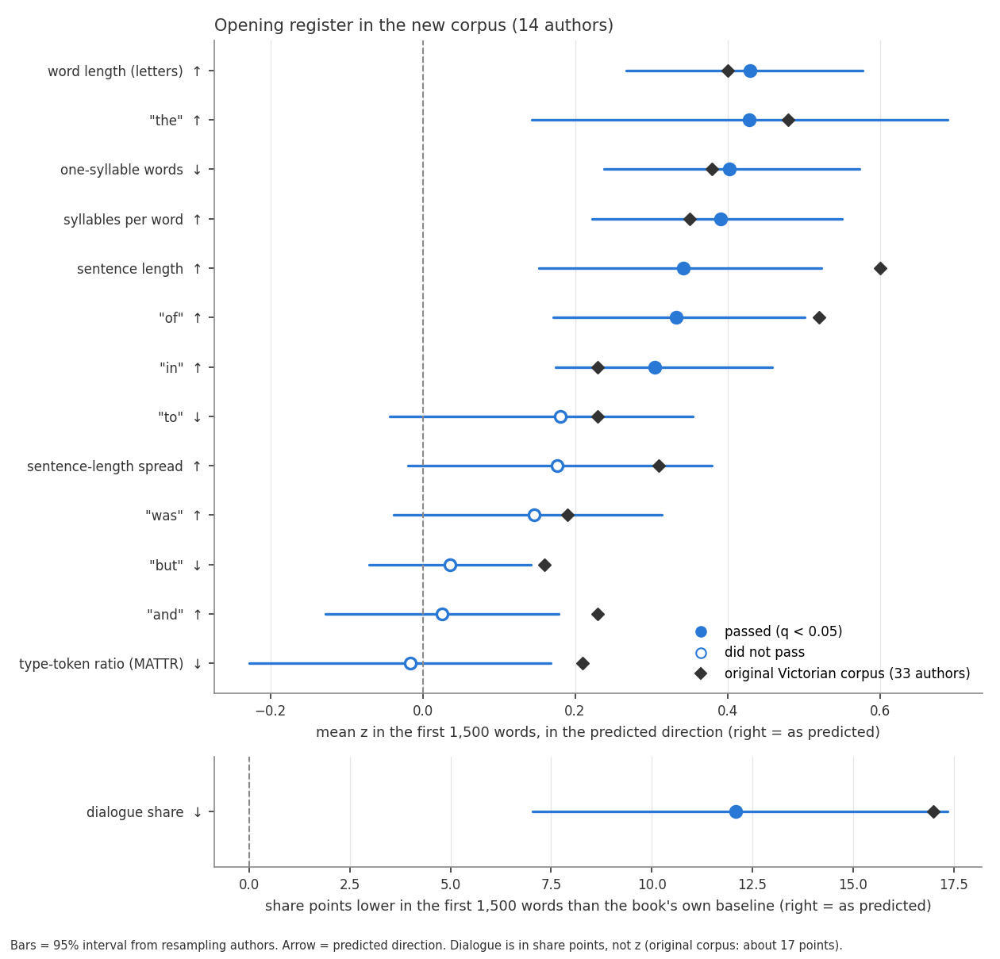

# Opening register test: results

Run 2026-11-11. Corpus folder: `..\Hathi_corpus_clean`. Predictions and thresholds were frozen in config.py before any new data was analysed.

## Verdict: **PARTIAL**

* 7 of 13 pre-chosen features shifted in the predicted direction (one-sided, FDR q < 0.05). CONFIRMED needs at least 9; PARTIAL is 5-8; below that is NOT FOUND.
* Dialogue share in the opening is lower: **yes** (mean -12.1 share points vs the book's own baseline, 12/14 authors lower, p = 0.0007).

## Corpus

14 authors, 55 books (at least 2 books per author, at least 20,000 words per book after trimming). Authors with detectable dialogue: 14.
Quote styles: double (55).
Before trusting this, open cuts.csv and check that each book starts at the story and not at a preface or contents page.

## The 13 tested features

z = how far the first 1,500 words sit from the book's own baseline (from word 6,000 on), in typical window-to-window SDs; averaged within author. "Predicted direction" counts authors who moved as predicted.

| feature | predicted | mean z (95% interval) | authors as predicted | q | pass | original corpus (mean z; authors) |
|---|---|---:|---:|---:|---|---:|
| sentence length | higher | +0.34 (+0.15 to +0.52) | 11/14 | 0.0066 | **yes** | +0.60; 29/33 |
| word length (letters) | higher | +0.43 (+0.27 to +0.58) | 13/14 | 0.0020 | **yes** | +0.40; 28/33 |
| "the" | higher | +0.43 (+0.14 to +0.69) | 12/14 | 0.0111 | **yes** | +0.48; 29/33 |
| "of" | higher | +0.33 (+0.17 to +0.50) | 12/14 | 0.0026 | **yes** | +0.52; 28/33 |
| sentence-length spread | higher | +0.18 (-0.02 to +0.38) | 9/14 | 0.0825 | no | +0.31; 25/33 |
| syllables per word | higher | +0.39 (+0.22 to +0.55) | 11/14 | 0.0027 | **yes** | +0.35; 28/33 |
| "in" | higher | +0.30 (+0.17 to +0.46) | 13/14 | 0.0020 | **yes** | +0.23; 26/33 |
| "and" | higher | +0.02 (-0.13 to +0.18) | 8/14 | 0.4166 | no | +0.23; 26/33 |
| "was" | higher | +0.15 (-0.04 to +0.31) | 10/14 | 0.0977 | no | +0.19; 21/33 |
| one-syllable words | lower | -0.40 (-0.57 to -0.24) | 12/14 | 0.0026 | **yes** | -0.38; 27/33 |
| "to" | lower | -0.18 (-0.35 to +0.04) | 9/14 | 0.0825 | no | -0.23; 25/33 |
| "but" | lower | -0.04 (-0.14 to +0.07) | 7/14 | 0.3232 | no | -0.16; 23/33 |
| type-token ratio (MATTR) | lower | +0.02 (-0.17 to +0.23) | 7/14 | 0.5576 | no | -0.21; 22/33 |

**Dialogue share** (predicted lower), in share points (not z; a z blows up for books with almost no dialogue): mean -12.1 (-17.3 to -7.0), 12/14 authors lower, p = 0.0007. In the original corpus dialogue was about 17 share points lower than in words 6,000-12,000.

## Placebo check

The same test at 50 random mid-book "openings" (baseline fitted outside them). By chance a feature passes one-sided at p < 0.05 about 5% of the time.

* Features with p < 0.05 per draw: mean 0.48 of 13 (about 0.65 expected).
* Features passing FDR per draw: mean 0.00, maximum 0.
* Draws that would have been called CONFIRMED: 0 of 50.

If the placebo passes many features, the test is too loose and the verdict above should not be trusted.

## Exploratory: the other 11 original features

Not part of the verdict. Two-sided tests, FDR across these 11.

| feature | mean z | authors same sign as mean | p | q | significant |
|---|---:|---:|---:|---:|---|
| semicolons | +0.27 | 11/14 | 0.0015 | 0.0161 | yes |
| "that" | -0.25 | 12/14 | 0.0173 | 0.0953 | no |
| questions | -0.15 | 9/14 | 0.0442 | 0.1554 | no |
| commas | +0.11 | 10/14 | 0.0565 | 0.1554 | no |
| "it" | -0.11 | 9/14 | 0.1051 | 0.2106 | no |
| "as" | +0.08 | 11/14 | 0.1149 | 0.2106 | no |
| hapax rate (MA) | +0.12 | 9/14 | 0.2710 | 0.3811 | no |
| coordinators | -0.11 | 9/14 | 0.2865 | 0.3811 | no |
| exclamations | +0.09 | 8/14 | 0.3427 | 0.3811 | no |
| subordinators | -0.07 | 9/14 | 0.3464 | 0.3811 | no |
| dashes | +0.05 | 6/14 | 0.5983 | 0.5983 | no |

## Limits

* Plain text loses italics, so italic thoughts or dialogue are not counted as dialogue.
* Translated authors mix translator style into author style.
* "Not found" can mean low power, not absence; compare the intervals with the original corpus.
* Sign-flip p-values are exact when there are 16 authors or fewer (p cannot go below 1/2^n); with more authors they come from 20,000 random flips (p cannot go below about 0.00005).
* Settings: 300-word windows, opening = first 5 windows, baseline from window 20, seed 20261017.
* Runtime 145s.
